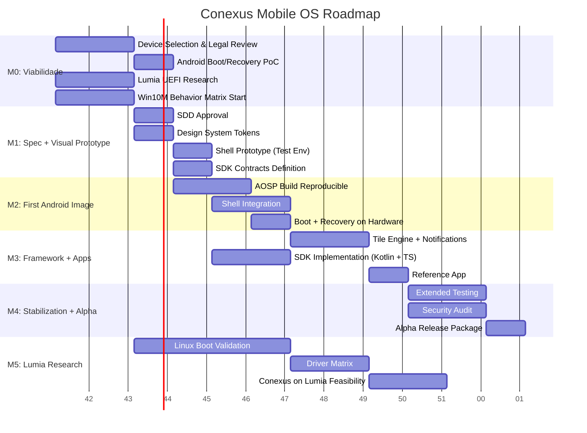

# Conexus Mobile OS — Roadmap

**Versão:** v0.1  
**Data:** 19 de outubro de 2026  
**Baseline:** Tech Plan v0.1

---

## Visão Geral dos Milestones



---

## M0 — Viabilidade e Inventário (Semanas 1-2) — **2026-10-19 a 2026-11-01**

### Objetivo
Validar se o projeto é tecnicamente viável antes de investir em desenvolvimento.

### Decisão de Device (Já Tomada)
| Device | Papel | Justificativa |
|--------|-------|---------------|
| **Google Pixel 8a (akita)** | **Primário** | Unlock trivial, kernel 6.1 GKI mainline, LineageOS oficial weekly, A/B + dynamic partitions, device tree/vendor upstream LineageOS |
| **Nothing Phone (2) (pong)** | **Backup** | Unlock trivial, kernel source OEM, A/B + dynamic, preço ~$400, mas device tree/vendor community-only |
| **OnePlus 12 (waffle)** | Terceira opção | Hardware top, mas $700+, LineageOS unofficial, carrier variant risks |
| **Xiaomi 14 (houji)** | ❌ Rejeitado | Unlock wait 7-168h + limite 1 device/ano, LineageOS closed/beta |

### Entregáveis
| Item | Responsável | Critério de Pronto | Prazo |
|------|-------------|-------------------|-------|
| `docs/architecture/DEVICE_SUPPORT.md` | A2 | **✅ CONCLUÍDO** — Matriz com 4 devices, decisão documentada | 2026-10-19 |
| `docs/re/LEGAL_BOUNDARIES.md` | A1 | Boundaries documentados e revisados por legal | 2026-10-25 |
| `docs/re/REFERENCE_INVENTORY.md` (inicial) | A1 | Build 15254.603, device, idioma, resolução, condições | 2026-10-25 |
| **Comprar 2x Pixel 8a** (primário + backup) | A0/A2 | Devices em mãos, números de série registrados | 2026-10-26 |
| **Factory Image Pixel 8a** — download + SHA-256 | A2 | `akita-factory-<build>.zip` validado | 2026-10-26 |
| **Stock Restore Test** — flash factory → boot → confirmar | A2 | Restore 100% funcional documentado | 2026-10-27 |
| **Bootloader Unlock Test** — `fastboot flashing unlock` | A2 | Unlock + wipe confirmado | 2026-10-27 |
| **LineageOS Recovery Test** — flash recovery → boot → factory reset | A2 | Recovery funcional, boot LineageOS | 2026-10-28 |
| Android Boot/Recovery PoC (Conexus) | A2 | Flash + boot + recovery em device físico | 2026-11-01 |
| Lumia UEFI Status Report | A2 | Modelo exato, UEFI boot status, drivers conhecidos | 2026-11-01 |
| ADRs Baseline aprovados | A0 | ADR-001 a ADR-008 assinados | 2026-10-25 |

### Gate M0: **Dispositivos Aprovados** — Target: **2026-11-01**
- [ ] **Pixel 8a comprado (2 units)** + factory image testado + restore comprovado
- [ ] **Bootloader unlock + LineageOS recovery** funcional no hardware
- [ ] Legal boundaries aprovados (revisão advogado IP)
- [ ] ADRs baseline (001-008) assinados por A0, Architect, A5
- [ ] Riscos R01, R02, R06 com mitigação ativa

---

## M1 — Especificação e Protótipo Visual (Semanas 3-4)

### Objetivo
SDD aprovado, design system, shell executável em ambiente de teste.

### Entregáveis
| Item | Responsável | Critério de Pronto |
|------|-------------|-------------------|
| SDD v1.0 assinado | A0 | Todos stakeholders aprovam |
| `shell/fluent/tokens/` | A3 | Cores, tipografia, motion, elevation, spacing — versionados |
| `shell/start/` (prototype) | A3 | Live Tiles renderizando, grupos, pastas, animações em desktop/emulator |
| `shell/navigation/` (prototype) | A3 | Gestos, back, task switch, transitions funcionando |
| `framework/sdk/contracts/` | A4 | Interfaces TypeScript/Kotlin, schemas JSON, versioning policy |
| `docs/re/BEHAVIOR_MATRIX.md` | A1 | 1 linha por recurso, critérios objetivos de equivalência |
| `docs/re/SCREEN_CATALOG.md` | A1 | Screens: Start, Tiles, Action Center, Settings, Keyboard, Nav, Lock |

### Gate M1: **Fluxos Essenciais Aprovados**
- [ ] Design system tokens aprovados por UI/UX review
- [ ] Shell prototype demonstra fluxos P0 (Start → App → Back → Action Center)
- [ ] SDK contracts reviewados por A3, A4, A5
- [ ] Behavior matrix completa para recursos P0/P1

---

## M2 — Primeira Imagem Android (Semanas 5-8)

### Objetivo
Build reproduzível, shell integrado, instalação em aparelho de teste, mecanismo de recuperação.

### Entregáveis
| Item | Responsável | Critério de Pronto |
|------|-------------|-------------------|
| AOSP build reproduzível | A2 | `lunch <target>; m -j$(nproc)` → `out/target/product/<device>/` |
| Shell integrado no system image | A3 + A2 | `system_ext` ou `product` partition com shell APK/JAR |
| Verified Boot (AVB/dm-verity) | A5 + A2 | Boot integrity verified, rollback protection |
| `docs/installation/ANDROID_INSTALL.md` | A7 | Passo a passo: unlock → flash → boot → recovery testado |
| Recovery procedure testado | A2 + A7 | Interromper update → restaurar imagem funcional |
| SELinux policy para shell/services | A5 | Enforcing mode, no denials em logs |

### Gate M2: **Boot e Recuperação Comprovados**
- [ ] Build limpo, reproduzível, versionado
- [ ] Flash em device físico → boot → shell carrega → touch funciona
- [ ] Recovery testado: update interrompido → restore automático funciona
- [ ] Security review (A5) passa: verified boot, SELinux, no secrets

---

## M3 — Framework e Aplicativos (Semanas 9-12)

### Objetivo
Tiles, notificações, SDK inicial, instalação e execução dos aplicativos de referência.

### Entregáveis
| Item | Responsável | Critério de Pronto |
|------|-------------|-------------------|
| `services/tile-engine/` | A3 + A4 | Tile updates, scheduling, rendering, failure handling |
| `services/notifications/` | A3 + A4 | Broker, grouping, quick actions, permissions |
| `framework/sdk/kotlin/` | A4 | TileProvider, NavController, NotificationBuilder, PermissionManager |
| `framework/sdk/typescript/` | A4 | Components, hooks, theme, native bridge |
| `apps/reference-app/` | A4 | Instala, cria tile live, envia/recebe notificação, navega |
| `framework/app-contracts/` | A4 | Manifest schemas, permission model, deep link contracts |
| `tests/integration/` | A6 | Shell + services + SDK + reference app integration tests |

### Gate M3: **MVP Funcional**
- [ ] Reference app roda no device: tile live update, notification, navigation
- [ ] SDK publica artefatos (Maven + npm local)
- [ ] Schema validation para app/tile/notification manifests
- [ ] Performance baseline: tile update < 100ms, nav 60fps, mem < 150MB

---

## M4 — Estabilização e Segurança (Semanas 13-16)

### Objetivo
Testes prolongados, consumo, atualização, recuperação, permissões, documentação → **Versão Alpha Instalável**

### Entregáveis
| Item | Responsável | Critério de Pronto |
|------|-------------|-------------------|
| Extended device tests (7 dias) | A6 | Zero critical crashes, battery ≤ metas |
| Battery profiling | A6 | Idle ≤ 1.5%/h, active ≤ 8%/h, suspend/resume OK |
| OTA Update mechanism | A2 + A5 + A4 | Signed payloads, integrity check, rollback testado |
| Security audit completo | A5 | Zero critical vulns, SBOM, license compliance |
| `docs/installation/` completo | A7 | Install guide, recovery guide, known issues, risks |
| Alpha release package | A7 | Images, SHA-256, signatures, changelog, SBOM |

### Gate M4: **Versão Alpha Instalável**
- [ ] Todos critérios de release Alpha atendidos (SDD §9)
- [ ] A0, A5, A6 aprovam
- [ ] Release package publicado com avisos de risco
- [ ] Chaves de produção usadas (isoladas de dev)

---

## M5 — Pesquisa Lumia e Expansão (Semana 17+)

### Objetivo
Validar inicialização Linux, drivers, interface e viabilidade de uma imagem Conexus específica para o Lumia escolhido.

### Entregáveis
| Item | Responsável | Critério de Pronto |
|------|-------------|-------------------|
| Linux ARM64 boot no Lumia | A2 | UEFI → GRUB → Kernel → initramfs → shell |
| Driver matrix por componente | A2 | Modem, câmera, áudio, touch, sensors, power — status each |
| `docs/installation/LUMIA_RESEARCH.md` | A7 | Procedimento, limitações, riscos, known issues |
| Conexus Shell no Lumia (se viável) | A3 | Touch, display, basic navigation |
| Feasibility report | A0 | Go/No-go para imagem Lumia dedicada |

### Gate M5: **Relatório por Modelo**
- [ ] Relatório individual por componente publicado
- [ ] Decisão: investir em imagem Lumia dedicada ou manter apenas pesquisa

---

## Dependências Críticas Entre Milestones

```
M0 (Device + Legal) 
    ├──→ M1 (Spec + Design) 
    │       ├──→ M2 (Android Image) ──→ M3 (Framework + Apps) ──→ M4 (Alpha)
    │       └──→ M5 (Lumia Research) [paralelo, não bloqueia M2-M4]
    └──→ M5 (Lumia UEFI Research) [inicia M0, continua independente]
```

**Regra:** M2-M4 são sequenciais no Android target. M5 é trilha paralela de pesquisa.

---

## Recursos Necessários

### Hardware (M0)
- [ ] 1x Device Android alvo (comprar após device selection)
- [ ] 1x Device Android backup (mesmo modelo)
- [ ] 1x Lumia 950 XL (ou 950) — para pesquisa
- [ ] PC Linux com 32GB+ RAM, 500GB+ SSD para AOSP builds
- [ ] Cables: USB-C, USB-A, possibly EDL/9008 cable para emergency recovery

### Software/Contas
- [ ] GitHub Org/Repo: `conexus-mobile-os`
- [ ] GHCR para container images / artifacts
- [ ] Maven/GHCR packages para Kotlin SDK
- [ ] npm/GHCR packages para TS SDK
- [ ] CI: GitHub Actions (Blacksmith 2 vCPU) ou self-hosted
- [ ] Sentry project (via API BFF padrão CONEXUS)
- [ ] Resend domain para notificações (via API BFF)

### Aprovações Humanas Necessárias
| Momento | Aprovação | Quem |
|---------|-----------|------|
| M0 Gate | Device selection, ADRs baseline | Tiago |
| M2 Gate | Flash em device físico | Tiago |
| M4 Gate | Alpha release distribution | Tiago |
| Qualquer flash destrutivo | Escrito por device | Tiago |
| Production signing keys | Geração/rotação | Tiago |
| Terraform apply prod | Se infra dedicada | Tiago |

---

## Métricas de Sucesso por Fase

| Fase | Métrica | Target |
|------|---------|--------|
| M0 | Devices com boot/recovery comprovado | ≥ 1 Android, Lumia UEFI status known |
| M1 | Fluxos P0 demonstráveis em prototype | 100% (Start, Tile, Nav, Action Center, Settings) |
| M2 | Boot success rate em device | 10/10 consecutive boots |
| M2 | Recovery success rate | 5/5 interrupted updates recovered |
| M3 | Reference app funcionalidade | Tile live, notif send/recv, nav — todos OK |
| M4 | Critical bugs aberto | 0 |
| M4 | Battery vs stock | ≤ 110% drain (idle + active) |
| M4 | Security critical vulns | 0 |
| M5 | Lumia components working | Documentado por componente |

---

## Próximas Datas-Chave

| Data | Evento |
|------|--------|
| 2026-10-19 | Baseline v0.1 criado |
| 2026-10-26 | Target: M0 Gate (Device + Legal + ADRs) |
| 2026-11-09 | Target: M1 Gate (Spec + Prototype) |
| 2026-12-07 | Target: M2 Gate (Boot + Recovery) |
| 2027-01-04 | Target: M3 Gate (MVP) |
| 2027-02-01 | Target: M4 Gate (Alpha) |
| 2027-03-01 | Target: M5 Report (Lumia) |

> Datas são estimativas para 1 dev principal + agentes IA. Ajustar conforme device availability e tempo real.